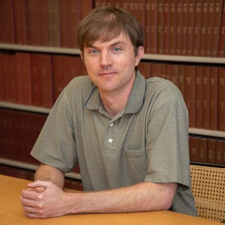

## Project team

<!-- Photos: square, 384×384px, compressed, in people/. Ryan's is his press
headshot (ryanoloughlin.org/media.html); Matthew's is his NCAR Library staff
photo. Both should confirm they're happy with them. -->

::: {.person}
{fig-alt="Portrait of Ryan O'Loughlin" width="128" height="128"}

::: {.person-text}
### [Ryan O'Loughlin](https://ryanoloughlin.org/)

[Principal investigator · Assistant Professor of Philosophy, Queens College,
City University of New York]{.role}

Ryan is a philosopher of science who studies scientific modeling, especially
how climate scientists gain trustworthy knowledge from imperfect models. He has
published on the philosophy of climate modeling and co-authored a perspective
paper on AI and climate science in *Geoscientific Model Development*
([O'Loughlin et al. 2025](https://doi.org/10.5194/gmd-18-787-2025)). Since 2019
he has interviewed scientists and made site visits at NSF NCAR and NASA GISS.
On this project he leads the philosophical analysis, co-conducts interviews,
and leads the publications on error, understanding and antifragility.

ryan.oloughlin [at] qc.cuny.edu
:::
:::

::: {.person}
{fig-alt="Portrait of Matthew Mayernik" width="128" height="128"}

::: {.person-text}
### [Matthew Mayernik](https://library.ucar.edu/directory/matt-mayernik)

[Co-principal investigator · Project Scientist and Research Data Services
Specialist, NCAR Library, NSF National Center for Atmospheric
Research]{.role}

Matthew studies how scientists create, describe and share data, with work
published in *Social Studies of Science*, information science journals and
Earth science venues. His study of how climate model intercomparison projects
earn credibility ([Mayernik 2021](https://doi.org/10.17351/ests2021.769)) is a
key starting point for this project. He has long experience with research
interviews and workshop organizing. On this project he co-leads the interviews
and document analysis, leads the workshop, and leads the publications on data
practices, documentation and institutional credibility.

mayernik [at] ucar.edu
:::
:::

## Advisory board

<!-- Checked October 2026 against each member's official page. Paul Edwards
retired from Stanford in January 2026; his profile lists him as emeritus at
the University of Michigan. Ask each member to confirm their line. -->

::: {.advisory-list}
- [Steve Easterbrook](https://www.environment.utoronto.ca/people/directories/all-faculty/steve-easterbrook)
  · [University of Toronto]{.affiliation}\
  Computer scientist and Director of the School of the Environment, who
  studies how climate models are built and tested as software; author of
  *Computing the Climate*.
- [Paul Edwards](https://profiles.stanford.edu/paul-edwards)
  · [University of Michigan (emeritus)]{.affiliation}\
  Historian of climate science and information infrastructure; author of
  *A Vast Machine: Computer Models, Climate Data, and the Politics of Global
  Warming*.
- [Travis O'Brien](https://earth.indiana.edu/directory/faculty/obrien-travis.html)
  · [Indiana University]{.affiliation}\
  Climate scientist working on extreme weather, climate modeling and machine
  learning; co-author of the project's background paper on AI and climate
  modeling.
- [Wendy Parker](https://sites.google.com/site/wendyparkerphilosophy/)
  · [Virginia Tech]{.affiliation}\
  Philosopher of science known for the "adequacy-for-purpose" view of how
  climate and weather models should be evaluated.
- [David Ribes](https://www.hcde.washington.edu/ribes)
  · [University of Washington]{.affiliation}\
  Sociologist of science and technology who studies research infrastructures
  and data, and directs the Data Ecologies Lab.
- [Gavin Schmidt](https://www.giss.nasa.gov/staff/gschmidt/)
  · [NASA Goddard Institute for Space Studies]{.affiliation}\
  Climate modeler and director of NASA's Goddard Institute for Space Studies.
- [Daniele Visioni](https://cals.cornell.edu/people/daniele-visioni)
  · [Cornell University]{.affiliation}\
  Climate scientist who models stratospheric aerosols and solar geoengineering,
  and co-chairs the Geoengineering Model Intercomparison Project (GeoMIP).
:::

## Partner institutions

- Queens College, City University of New York
- NSF National Center for Atmospheric Research
